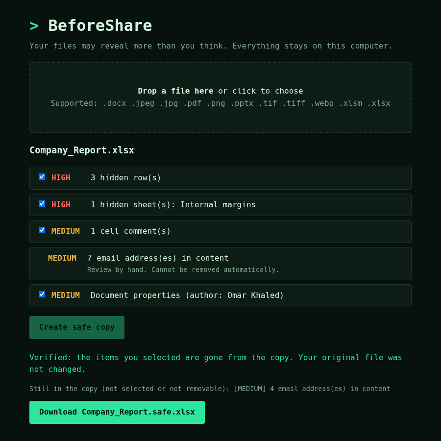

# BeforeShare

[](https://github.com/mohamed-elshamy-ai/beforeshare/actions/workflows/tests.yml)  

**Your files may reveal more than you think.** BeforeShare scans a file for hidden data before you send or publish it, lets you choose what to remove, writes a safe copy, and then **scans the copy again** to check the removal worked. Your original file is never changed.

Runs fully offline. No AI model, no cloud: every check is a plain rule you can read in the code.

## What it checks

| File type | Found and removable | Found, review by hand |
|---|---|---|
| Excel `.xlsx` `.xlsm` | hidden sheets (incl. very hidden), hidden rows and columns, cell comments, external links, author metadata | emails, phone numbers, card numbers (Luhn checked), 14-digit national IDs, API keys and passwords in cell text |
| Word `.docx` | tracked changes (deleted text is still stored), comments, hidden text, author metadata | same text checks |
| PDF `.pdf` | author/creator metadata, XMP, annotations, embedded attachments, auto-run actions | white, tiny or invisible-mode text (reported, not removed), form fields, same text checks |
| PowerPoint `.pptx` | hidden slides, speaker notes, review comments, author metadata | emails, phones, cards, IDs, secrets in slide text |
| Images `.jpg` `.png` `.tiff` `.webp` | GPS location, capture time, camera or phone model, owner and software tags | none |

## Install

```bash
git clone https://github.com/mohamed-elshamy-ai/beforeshare
cd beforeshare
pip install -e .
```

Python 3.9+. The window needs only a web browser.

## Use

```bash
beforeshare scan Company_Report.xlsx          # report only
beforeshare scan Company_Report.xlsx --json   # for scripts
beforeshare clean Company_Report.xlsx         # writes Company_Report.safe.xlsx and verifies it
beforeshare clean file.xlsx --only xlsx.hidden_sheet,xlsx.comments
beforeshare-gui                               # opens a window in your browser (local only): drop a file, tick, download
```

Real output from `demo/Company_Report.xlsx` (see [`demo/demo-output.txt`](demo/demo-output.txt)):

```
BeforeShare Report

File: demo/Company_Report.xlsx

Found:

  [HIGH] 3 hidden row(s)
  [HIGH] 1 hidden sheet(s): Internal margins
  [MEDIUM] 1 cell comment(s)
  [MEDIUM] 7 email address(es) in content  (review manually, cannot be removed automatically)
  [MEDIUM] Document properties (author: Omar Khaled)
```

Exit codes: `scan` returns 1 if a HIGH item is found (useful in scripts), 0 otherwise. `clean` returns 2 if verification fails. 3 means the file could not be read.

## Install on Windows, macOS and Linux

Needs Python 3.9 or newer. On Windows install it from python.org and tick "Add python.exe to PATH".

```bash
# Windows (PowerShell):  py -m pip install git+https://github.com/mohamed-elshamy-ai/beforeshare
# macOS:                 python3 -m pip install git+https://github.com/mohamed-elshamy-ai/beforeshare
# Linux:                 python3 -m pip install --user git+https://github.com/mohamed-elshamy-ai/beforeshare
```

Tested on Linux only. Android: no app; Termux is untested. Technical notes (architecture, algorithms, testing): [ARCHITECTURE.md](ARCHITECTURE.md). Website: https://mohamed-elshamy-ai.github.io/beforeshare/

## Worked examples

PowerPoint with a hidden pricing slide and speaker notes that say "do not tell the client" ([`demo/Pitch_Deck.pptx`](demo/Pitch_Deck.pptx)):

```
$ beforeshare scan demo/Pitch_Deck.pptx
  [HIGH] 1 hidden slide(s): 2
  [HIGH] Speaker notes on 1 slide(s): 1
  [MEDIUM] 1 email address(es) in content  (review manually, cannot be removed automatically)
  [MEDIUM] Document properties (author: Omar Khaled, Steve Canny)

$ beforeshare clean demo/Pitch_Deck.pptx
Safe copy written: demo/Pitch_Deck.safe.pptx
Original file was not changed.
Verification: rescanned the copy, the selected items are gone.
```

A PDF with white text no reader can see ([`demo/Report_hidden.pdf`](demo/Report_hidden.pdf)):

```
$ beforeshare scan demo/Report_hidden.pdf
  [HIGH] Text that is invisible on the page: 1 white, 0 tiny, 0 invisible-mode span(s). ...
```

The window, after dropping `Company_Report.xlsx` and pressing "Create safe copy":



## How it works

1. **Detect** the file type by extension.
2. **Parse** it with a normal library (openpyxl, python-docx, pikepdf, Pillow).
3. **Scan** for hidden content and metadata, then run text rules over the visible content for secrets and personal data.
4. **Report** each finding with a severity (HIGH, MEDIUM, LOW).
5. **Safe copy**: write a new file without the items you selected. The original stays untouched.
6. **Verify**: scan the new file again. If anything you asked to remove is still there, the command says so and exits with code 2.

## Limitations

- The window (`beforeshare-gui`) is a local web page served on 127.0.0.1 with a random token. It is tested end to end in a real Chrome (`tests/e2e_gui.py`, screenshots in `demo/gui-*.png`), not on every OS and browser.
- **A safe copy is not a guarantee that a file is safe.** BeforeShare only knows the checks listed above. It can miss things and can flag harmless text.
- Text rules (emails, phones, cards, IDs, secrets) are pattern matches. They are reported for you to review. They are not removed automatically.
- Excel: the copy is rewritten with openpyxl. Charts, images and pivot tables may be lost, and formulas pointing at removed rows may change. Check the copy.
- Word: accepting tracked changes means insertions are kept and deletions removed. Text in text boxes, footnotes and embedded objects is not inspected.
- PDF: removed-by-drawing "redactions" are **not** detected. White or tiny hidden text is only detected with the optional `deeppdf` extra. Metadata and annotations are handled.
- Images: removal rebuilds the image from its pixels. JPEG is saved again at quality 95, which is lossy. Metadata inside the picture itself (a visible location sign) is not touched.
- PowerPoint: hidden slides, notes, comments and metadata. Images, charts and embedded files inside slides are not inspected. Other formats (.doc, .xls, .ppt, .odt) are not supported.
- PDF hidden text is detected but not removed (the page has to be recreated). Scanned PDFs that have an OCR layer also trigger it.
- **PyMuPDF is optional.** The PDF hidden-text check and the PDF body-text rules need PyMuPDF, which is AGPL-3.0, so BeforeShare does not install it by default. Without it, PDF metadata, annotations, attachments and auto-run actions are still checked. To turn the deep check on: `pip install "beforeshare[deeppdf]"` (you accept PyMuPDF's AGPL terms for your own copy).

## Development

```bash
pip install -e ".[dev]"
pytest
```

Tests build their own sample files, run scan and clean on them, and check that the original is byte-for-byte unchanged and that the safe copy passes verification.

## Roadmap

Optional Presidio-based name detection, removal of PDF hidden text, embedded-object inspection. None of these exist yet.

## License

MIT

## Related tools

Metadata cleaners such as [mat2](https://github.com/jvoisin/mat2) already exist and are more complete for many file formats. What BeforeShare adds is a before-you-send check that also reports hidden content inside Office files and PDFs (for example hidden text), shows what it found, and produces a verified safe copy by re-scanning it. This is a narrower, checked workflow, not a new idea in metadata removal.
